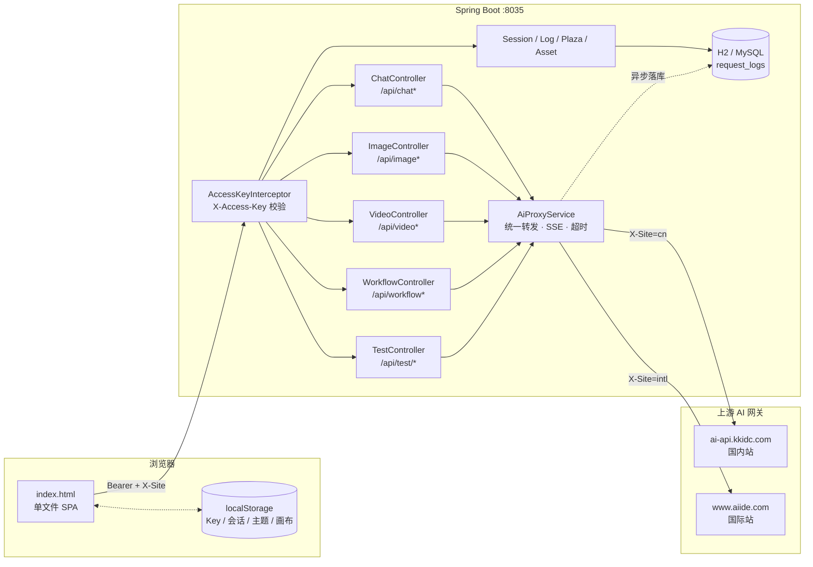

<div align="center">

# 🧠 AI Studio · 多模态 AI 聚合工作台

**一个后端、一个 HTML 文件，把文字 / 图像 / 视频 / 工作流 / 压测 / 巡检全都装进去**

[](https://openjdk.org/)
[](https://spring.io/projects/spring-boot)
[](#why)
[](#config)
[](#start)
[](#start)

[功能总览](#features) · [界面导航](#nav) · [架构](#arch) · [快速开始](#start) · [配置](#config) · [API](#api) · [FAQ](#faq)

</div>

---

## 📖 这是什么

一个**自用的多模态 AI 聚合客户端**：把「Anthropic Messages / OpenAI 兼容 / 火山豆包视频 / MiniMax 视频 / 图像生成与理解」这些格式各异的上游接口，收敛到一套统一的 Web 界面和一个 Spring Boot 代理后面。

没有前端构建、没有 `node_modules`、没有微服务 —— 整个 UI 就是 `src/main/resources/static/index.html` 一个文件，`java -jar` 起来就能用。

```text
浏览器（单文件前端，Token 存在本机 localStorage）
        │  Authorization: Bearer <你的 Key>   X-Site: cn | intl
        ▼
Spring Boot 代理（8035）── 统一鉴权 / 格式转换 / SSE 转发 / 请求日志
        │
        ├── ai-api.kkidc.com   国内站（Anthropic + OpenAI + 豆包 + MiniMax）
        └── www.aiide.com      国际站
```

**设计原则**：后端不保存用户 Token（每次请求由浏览器带上，转发完即弃），所以可以安全地多人共用一个实例；需要收口时打开 `ai.access-key` 即可。

---

<a id="features"></a>

## ✨ 功能总览

<table>
<tr>
<td width="50%" valign="top">

**💬 文字对话**

- 真流式输出（SSE 逐字打字机效果）
- 自动识别三种上游格式：Anthropic `messages` / OpenAI `chat/completions` / Responses
- 会话管理：多会话、历史摘要压缩、记忆模型独立设置
- 附件对话（图片 / 文本文件，后端按模型重写成 `image_url` / `source` / `inlineData`）
- 工具调用循环（`/api/chat/tools`，最多 4 轮）
- 参数面板：temperature / top_p / max_tokens / thinking
- 一键导出 cURL

</td>
<td width="50%" valign="top">

**🎨 图像**

- 文生图 / 图生图 / 参考图编辑（最多 4 张）
- 非流式与流式双通道（优先流式，最长 600s）
- OpenAI 与 Gemini 两种响应格式统一解析
- 批量生成：同一参数 N 张并发，SSE 实时进度卡片，可中途停止
- 蒙版编辑 / 图像理解（URL 或 base64）
- 素材库：上传、列表、详情，生成结果可直接入库

</td>
</tr>
<tr>
<td valign="top">

**🎬 视频**

- 三套上游接口统一封装：
  - 火山豆包任务式 `/api/v3/contents/generations/tasks`
  - V1 风格 `/v1/video/generations`
  - MiniMax 提交 + 轮询
- 文生视频 / 图生视频 / 视频参考 / 素材（`asset_id`）引用
- 提交后自动轮询进度、超时保护、结果预览与下载
- 国际站独立出口（`submit-intl`）

</td>
<td valign="top">

**🕸️ 工作流**

- 画布式编排，10 种节点：开始 / 文本 / 对话 / 图像 / 视频 / 条件 / 多分支 / 循环 / 汇合 / 结束
- 节点输出可被下游引用，汇合节点聚合多路结果
- 后端 DAG 执行 + 前端轮询进度，逐节点展示耗时与产物
- 画布状态持久化到 `localStorage`

</td>
</tr>
<tr>
<td valign="top">

**🧪 测试与观测**

- **批量压测**：多条提示词并发同一模型，统计成功率与耗时
- **A/B 对比**：两个模型同题作答并排对照
- **缓存测试**：显式 / 隐式缓存命中率与计费差异
- **模型巡检**：遍历主 Key 下全部模型逐个试探，输出可用性与耗时（支持国内站 / 国际站并排对比）
- **工具测试 / 原始请求 / JSON 直发**：手写 payload 直接打上游，绕过所有封装
- **请求日志**：全量落库（H2 / MySQL），可按站点过滤、查看原始请求响应、导出 Excel

</td>
<td valign="top">

**🏪 模型广场**

- 拉取上游定价表（含未在页面展示的隐藏 / 海外模型）
- 展示上下文长度、价格区间、能力标签
- 服务端缓存 5 分钟，令牌不下发浏览器

**🔑 多 Key 管理**

- 每个站点可存多个 Key，**一个主 Key** 决定全站模型清单与额度
- 想用别的模型？把另一个 Key「设为主 Key」即可，全站下拉立刻切换
- 主 Key 遇到 401/403/429 时，自动用同样支持该模型的备用 Key 兜底
- 单 Key 可单独测试连通性、启停、删除；模型清单独立缓存

**🔔 完成通知**

- 对话 / 图像 / 批量 / 视频 / 工作流完成时提醒
- 三层可组合：桌面系统通知（需授权）、WebAudio 提示音、标题未读角标
- 页面在前台只弹底部 toast，切到后台才走系统通知，不打扰

</td>
</tr>
</table>

---

<a id="nav"></a>

## 🧭 界面导航

左侧一共 13 个页签，覆盖「用」和「测」两条线：

| 页签 | 作用 |
| --- | --- |
| 💬 文字对话 | 流式对话、会话管理、附件、工具调用、参数调节 |
| 🎨 图像生成 | 文生图 / 图生图 / 参考图编辑 / 批量出图 / 蒙版 |
| 🎬 视频生成 | 文生视频 / 图生视频 / 视频参考 / 轮询结果 |
| 🏪 模型广场 | 上游定价与上下文信息 |
| 📦 素材库 | 素材上传、列表、详情（供视频 `asset_id` 引用） |
| 🕸️ 工作流 | 画布编排 + DAG 执行 + 结果卡片 |
| 🧠 缓存测试 | 缓存命中率与成本验证 |
| ⚡ 压测 | 多提示词并发压力测试 |
| ⇄ A/B 对比 | 双模型同题对照 |
| 🔍 模型巡检 | 全模型可用性巡检 + 站点对比 |
| 📜 请求日志 | 原始请求/响应、cURL 复制、Excel 导出 |
| 🛠 工具测试 | 工具调用单独调试 |
| 📤 原始请求 | 手写 JSON 直发上游任意路径 |

另有一页 `static/api-docs.html`：上游接口速查 + 在线请求，方便对照官方文档调参。

---

<a id="arch"></a>

## 🏗 架构



**关键设计**

| 决策 | 原因 |
| --- | --- |
| Token 由浏览器携带，后端不落盘 | 一个实例可以多人共用，谁的 Key 花谁的额度 |
| `X-Site` 头切换国内/国际出口 | 同一份代码服务两套上游，前端一个开关就切 |
| SSE 全链路透传（`TEXT_EVENT_STREAM`） | 对话和批量出图都能实时看到进度，而不是等 600 秒 |
| 请求日志用 JdbcTemplate + 建表脚本 | 零 ORM 依赖，H2 文件库开箱即用，想换 MySQL 只加 profile |
| 前端不用框架、不用构建 | 改一行刷新即见，部署只有一个 jar |

---

<a id="start"></a>

## 🚀 快速开始

### 环境要求

- JDK **17+**
- Maven（仓库自带 `mvnw`，无需预装）
- 不需要 Node.js / npm

### 1. 克隆

```bash
git clone https://github.com/chenyujie471/IT-technology.git
cd IT-technology
```

### 2. 改配置

打开 `src/main/resources/application.yaml`，至少确认这两项上游地址（一般无需改动）：

```yaml
ai:
  upstream: https://ai-api.kkidc.com      # 国内站
  upstream-intl: https://www.aiide.com    # 国际站
```

> 用户侧的 API Key **不在配置文件里**，而是首次打开页面时在「⚙ API 配置」里添加，只存你浏览器本地。

### 3. 运行

```bash
# Windows
mvnw.cmd spring-boot:run

# macOS / Linux
./mvnw spring-boot:run
```

或先打包再跑：

```bash
./mvnw clean package -DskipTests
java -jar target/IT-technology-0.0.1-SNAPSHOT.jar
```

### 4. 打开

浏览器访问 **<http://localhost:8035>**，首次会自动弹出配置页：

1. 点「＋ 添加 Key」，填备注名（如 `家用-1`）、选站点（国内/国际）、粘贴 Token
2. 保存后它自动成为该站点**主 Key**，并拉取可用模型列表
3. 关掉弹窗，开始用

> 页面地址后面加 `/api-docs.html` 可打开上游接口速查页。

---

<a id="config"></a>

## ⚙️ 配置说明

`src/main/resources/application.yaml` 主要项：

| 配置 | 默认 | 说明 |
| --- | --- | --- |
| `server.port` | `8035` | 服务端口 |
| `spring.mvc.async.request-timeout` | `660000` | 异步请求超时（660s，覆盖出图最长 600s） |
| `spring.servlet.multipart.max-file-size` | `20MB` | 单张参考图上限 |
| `spring.servlet.multipart.max-request-size` | `80MB` | 4 张参考图总量上限 |
| `ai.upstream` / `ai.upstream-intl` | 见上 | 国内站 / 国际站上游网关 |
| `ai.access-key` | 空 | 填写后所有 `/api/**` 必须带 `X-Access-Key`，否则 403；留空不校验 |
| `ai.cors-allowed-origins` | `[]` | 允许的跨域来源，留空只允许同源 |
| `ai.plaza.pricing-url` | `kkhub.com/api/pricing` | 模型广场定价数据源 |
| `ai.plaza.token` | 空 | 广场定价接口的系统令牌，**建议用环境变量 `AI_PLAZA_TOKEN` 注入，不要写进仓库** |
| `ai.plaza.cache-seconds` | `300` | 广场结果缓存 |

### 数据库

默认 **H2 文件模式**，零配置、重启不丢，库文件在 `./data/db.mv.db`：

```bash
# 换库文件位置（工作目录不可写时尤其有用）
AI_DB_PATH=/var/lib/ittechnology/db   # 或 --spring.datasource.url=jdbc:h2:file:...
```

想用 MySQL：

```bash
java -jar app.jar --spring.profiles.active=mysql
```

然后改 `application-mysql.yaml` 里的连接串与账号密码（建表脚本 `schema1.sql` 会自动执行）。

### 用环境变量覆盖（推荐，避免改文件）

```bash
export AI_DB_PATH=/var/lib/ittechnology/db
export SERVER_PORT=8035
export AI_ACCESS_KEY=your-shared-secret
```

Spring Boot 的宽松绑定规则：`ai.access-key` ← `AI_ACCESS_KEY`，`server.port` ← `SERVER_PORT`。

---

## 🔑 多 Key 与主 Key

这是本项目的核心交互，值得单独说：

- **每个站点（国内站 / 国际站）各有一个主 Key**，全站所有页面的模型下拉、额度消耗，都来自它。
- 列表里主 Key 排在最前并带绿色徽标；其他 Key 平时只作**备用**。
- 想用别的模型？点那个 Key 的「**设为主 Key**」，全站模型列表立刻换成它的 —— 不用改任何其他设置。
- 底部一行实时告诉你：`主 Key：家用-1（38 个模型） · 备用 2 个（仅主 Key 失败时兜底） · 其他 Key 独有模型 5 个：sora-2、veo-3…（设为主 Key 后可用）`
- **只有**主 Key 返回 `401 / 403 / 429` 时，才会自动切到「同样支持该模型的」备用 Key 兜底，避免限流直接失败。
- 视频任务会记住提交它的那个 Key，轮询固定复用同一个（否则跨账号查不到任务）。

Key 存在浏览器 `localStorage` 的 `ai_keys_v1` 里，换浏览器 / 清缓存需要重新添加。

---

<a id="api"></a>

## 📡 API 一览

所有接口都以 `/api` 开头，鉴权：`Authorization: Bearer <Key>` + `X-Site: cn|intl`（可选的 `X-Access-Key` 用于服务级收口）。

<details open>
<summary><b>对话与模型</b></summary>

| 方法 | 路径 | 说明 |
| --- | --- | --- |
| `POST` | `/api/chat` | 流式对话，返回 `text/event-stream`，自动适配 Anthropic / OpenAI 格式 |
| `POST` | `/api/chat/attach` | 带附件的非流式对话（后端按模型重写附件结构） |
| `POST` | `/api/chat/tools` | 工具调用循环（最多 `max_rounds` 轮），返回工具卡片 + 最终文本 |
| `GET` | `/api/chat/tools` | 可用工具清单 |
| `GET` | `/api/models` | 代理上游 `/v1/models` |
| `POST` | `/api/verify` | 校验 Token 有效性 |
| `GET` | `/api/health` | 健康检查 |


</details>

<details open>
<summary><b>图像</b></summary>

| 方法 | 路径 | 说明 |
| --- | --- | --- |
| `POST` | `/api/image` | 生成图像（OpenAI 格式，优先流式，最长 600s） |
| `POST` | `/api/image/edit` | 参考图编辑，`multipart/form-data`，最多 4 张 |
| `POST` | `/api/image/batch` | 批量生成，SSE 实时推送每张进度，可中途取消 |
| `POST` | `/api/image/understand` | 图像理解（`image_b64` 或 URL + prompt） |
| `POST` | `/api/raw` | 原始 JSON 透传 |


</details>

<details open>
<summary><b>视频</b></summary>

| 方法 | 路径 | 说明 |
| --- | --- | --- |
| `POST` | `/api/video/submit` | 豆包任务式提交（文生 / 图生 / 视频参考 / 素材引用） |
| `GET` | `/api/video/poll/{taskId}` | 查询任务进度与产物 |
| `POST` | `/api/video/submit-intl` | 国际站提交 |
| `GET` | `/api/video/poll-v1/{taskId}` | V1 风格（`/v1/video/generations`）轮询 |
| `POST` | `/api/video/submit-minimax` | MiniMax 提交 |
| `GET` | `/api/video/poll-minimax/{taskId}` | MiniMax 轮询 |


</details>

<details open>
<summary><b>平台能力</b></summary>

| 方法 | 路径 | 说明 |
| --- | --- | --- |
| `GET/POST` | `/api/sessions` | 会话列表 / 新建 |
| `GET/PATCH/DELETE` | `/api/sessions/{id}` | 会话详情 / 改标题或模型 / 删除 |
| `POST/DELETE` | `/api/sessions/{id}/messages` | 追加 / 清空消息 |
| `POST` | `/api/sessions/{id}/summarize` | 历史摘要压缩 |
| `POST` | `/api/workflow/start` | 提交工作流 DAG |
| `GET` | `/api/workflow/status/{id}` | 各节点状态与产物 |
| `GET/DELETE` | `/api/logs` | 请求日志查询 / 清空 |
| `GET` | `/api/logs/count` | 日志条数 |
| `GET` | `/api/logs/export` | 导出 Excel（Apache POI） |
| `GET` | `/api/plaza` | 模型广场定价（服务端缓存） |
| `POST` | `/api/asset/upload` | 上传素材到上游素材库 |
| `GET` | `/api/asset/list` | 素材列表 |
| `GET` | `/api/asset/{assetId}` | 素材详情 |


</details>

<details>
<summary><b>测试套件 <code>/api/test/*</code></b></summary>

| 路径 | 说明 |
| --- | --- |
| `batch` | 多提示词并发压测 |
| `ab` | 双模型同题对比 |
| `cache` / `cache-explicit` | 隐式 / 显式缓存测试 |
| `scan` | 全模型巡检（可用性 + 耗时） |
| `jsontest` | 结构化输出 / JSON Schema 校验 |
| `raw` | 任意路径原始请求 |
| `perf` | 性能基准 |
| `capability` | 模型能力体检（数学 / 代码 / 翻译 / 结构化） |
| `video-generate` | 视频 JSON 直发 |
| `video-understand` | 视频理解 |
| `image-mask` | 蒙版编辑 |


</details>

---

## 📁 目录结构

```text
IT-technology/
├─ src/main/java/com/example/ittechnology/
│  ├─ controller/          # 12 个 REST 控制器（对话/图像/视频/工作流/日志/广场/素材/测试…）
│  ├─ service/             # 代理转发、工作流 DAG、工具调用、会话、日志、广场
│  ├─ config/              # AccessKeyInterceptor（服务级鉴权）、CORS
│  └─ util/                # 图片 MIME 嗅探等
├─ src/main/resources/
│  ├─ static/index.html    # 单文件前端（全部页面 + 状态管理，约 8k 行）
│  ├─ static/api-docs.html # 上游接口速查 + 在线调试页
│  ├─ schema1.sql          # request_logs 建表脚本
│  ├─ application.yaml
│  └─ application-mysql.yaml
├─ *.md                    # 上游接口参考（对话/图像/视频/素材/技术方案）
├─ pom.xml
└─ mvnw / mvnw.cmd
```

---

<a id="why"></a>

## 为什么前端只有一个 HTML 文件？

因为它是**自用工具**，优化目标是「改一行就能看到效果」：

- 没有打包步骤：改 `index.html` → 刷新浏览器，不需要 `npm run dev`、不需要等 HMR
- 没有依赖风暴：不用维护 `package-lock.json`，几年后 clone 下来照样跑
- 部署极简：整个产物就是一个 jar，前端资源跟着 Spring Boot 一起发
- 代价：单文件确实长（8k 行），靠清晰的注释分区（`// ===== 状态 / Key 管理 / 通知 / 渲染 =====`）和 `function` 声明式组织来维持可读性

如果你要把它做成多人协作产品，这个文件应该拆成组件 + 构建链；但对「一个人高频改」的场景，单文件反而是最顺手的。

---

<a id="faq"></a>

## ❓ 常见问题

<details>
<summary><b>出图经常 504 / 超时？</b></summary>

上游出图最长可达 10 分钟，确认 `spring.mvc.async.request-timeout` 足够（默认 660000ms），并且反向代理（Nginx）的 `proxy_read_timeout` 也调大。

</details>

<details>
<summary><b>启动报 <code>AccessDeniedException: /www/.../data</code></b></summary>

H2 库文件路径按**进程工作目录**解析。给该目录写权限，或用环境变量换位置：

```bash
mkdir -p /var/lib/ittechnology/data && chown <运行用户> /var/lib/ittechnology/data
AI_DB_PATH=/var/lib/ittechnology/data/db java -jar app.jar
```

</details>

<details>
<summary><b>切换站点后模型列表不对？</b></summary>

模型列表来自**当前站点的主 Key**。国内站和国际站各有一个主 Key，切站点会各自加载自己的清单；如果提示「模型列表未拉取」，点「🔄 刷新模型」。

</details>

<details>
<summary><b>完成通知没弹出来？</b></summary>

桌面通知需要浏览器授权（在配置里勾选时会请求），且**只在页面打开期间有效**。页面在前台时只有底部 toast + 提示音，切到后台才会发系统通知。

</details>

<details>
<summary><b>端口被占用</b></summary>

```bash
java -jar app.jar --server.port=8036
```

</details>

<details>
<summary><b>能不能多人共用一套？</b></summary>

可以。后端不存用户 Token，每个人在各自浏览器里配自己的 Key 即可。若要防止实例被随意调用，设置 `ai.access-key` 并在前端请求头里带上 `X-Access-Key`。

</details>

---

## ⚠️ 使用须知

- 本项目是**个人自用工具**，不是面向公网的产品，缺少限流、审计、多租户隔离等能力，请勿直接暴露在公网。
- 模型 ID、路径、价格均以**上游网关为准**，上游变更可能导致某个功能失效，`*.md` 里保留了各接口的原始文档便于对照。
- **不要把真实 API Key 提交到仓库**。仓库里的 `application.yaml` / `application-mysql.yaml` 含有服务端令牌与数据库口令字段，公开前请改为环境变量注入，并轮换已泄露的值。
- `data/` 目录是运行时 H2 数据库（含请求日志），已加入 `.gitignore`，不要提交。
- 仓库暂未附带 LICENSE 文件，若要正式开源可自行补充（如 MIT / Apache-2.0）。
- 仅用于学习与自用，请遵守所使用上游服务商的条款。

---

<div align="center">
<sub>Built for one person, used every day. 如果对你有帮助，欢迎 Star ⭐</sub>
</div>
